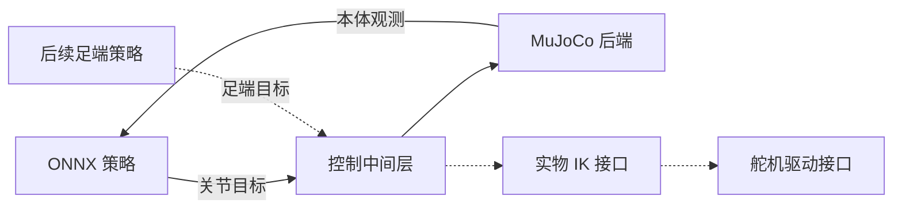

# 工作空间架构

| 路径 | 职责 |
| --- | --- |
| `src/dog_controller` | 标准本体观测、关节和足端命令、后端协议、校验、URDF |
| `src/dog_policy` | ONNX 校验与推理、观测历史、策略版本命令 |
| `src/dog_sim` | MJCF、参考窗口构造、MuJoCo 后端、仿真 ROS 节点 |
| `src/dog_hardware` | 实物占位节点、IK 与舵机驱动协议 |
| `policies/deploy` | 用于推理的版本化 ONNX、策略清单和当前版本标记 |
| `motions/dog` | 默认播放片段和精简清单。完整动作库位于训练仓库 |
| `tests`、`docs/experiment_data` | 回归、ROS 验收、实验脚本与逐片段数据 |

## 数据流

在仿真进程内，`dog_sim` 从物理状态读取关节位置、速度、机体角速度及投影重力。`dog_policy` 按分项、项内时间从旧到新的方式排列 10 帧观测。重播时用首帧填满历史，上一动作初始化为零。参考窗口由当前动作帧和后续九帧构成，靠近结尾时重复末帧。策略将原始动作保存在历史中，再映射为目标角，由 `dog_controller` 按关节名校验与排序后转给仿真后端。每次循环推进四个物理步，发布步进后的反馈。

实物入口使用足端目标。接口将四足位置在 `trunk` 坐标系下传给未来的 IK，再交由舵机驱动应用实物标定、反馈和设备时序。仿真和实物对上使用相同的观测及目标类型。当前策略的动作是关节目标。足端策略接入和实物 IK 按实物接口定义推进。

## ROS 接口

| 名称 | 类型 | 行为 |
| --- | --- | --- |
| `/dog_sim/play` | `std_srvs/srv/Trigger` | 重置片段和观测历史，从首帧开始 |
| `/dog_sim/stop` | `std_srvs/srv/Trigger` | 暂停物理步进 |
| `/joint_states` | `sensor_msgs/msg/JointState` | 12 个规范关节名及位置和速度 |
| `/clock` | `rosgraph_msgs/msg/Clock` | 累计仿真时间，重播后继续递增 |

`policy_dir`、`motion_dir`、`policy_version`、`clip`、`viewer`、`preview` 是仿真节点的启动参数。仿真容器默认启用 `viewer` 和 X11。MuJoCo 窗口显示仿真状态副本，默认自动循环播放参考片段。可通过 `preview:=false` 关闭自动预览。空格键通过 ROS 控制循环触发播放或暂停，`/dog_sim/play` 服务执行单次播放。关节使用弧度及弧度每秒。机体坐标是 X 前、Y 左、Z 上。足端位置使用米，投影重力为单位向量。默认片段时长为 2 秒。策略周期为 50 Hz，MuJoCo 步长为 5 毫秒。暂停时物理时间冻结。

## 速度遥控

`mode:=teleop` 使节点使用持续步进的遥控会话。终端键盘和 `cmd_vel` 订阅共用速度输入，控制量为机体前向速度和偏航角速度。命令超时后，参考速度按限加速度降到零。规划器根据当前步态相位及速度，使用 MuJoCo 模型的腿部几何和 IK 生成未来 10 帧参考，并沿用 `dog-v2` 的 50 Hz 观测与推理。合成步态是关节目标的基准，策略输出作为限幅修正。遥控期间仿真躯干自由运动，完整的 NPZ 动作库不参与该流程。

## 镜像与迁移

镜像的构建上下文限定在 `docker/`，构建阶段安装 ROS 运行依赖。仿真容器通过 Compose 挂载整个工作空间，实物容器只读挂载 `dog_controller` 的代码和包描述、`dog_policy`、`dog_hardware` 和 ONNX 部署目录。实物挂载闭包不包含 URDF、网格、MJCF、动作库或原始 checkpoint。两个服务使用长驻开发容器，通过 `docker compose exec` 进入并手动启动 ROS 节点。首次缺少安装产物时用 `colcon` 构建挂载的包，产物保存在 `/opt/dog` 下的独立 Docker 命名卷中。仿真开发脚本优先复用已有容器，源码变更时可以在同一容器内重新构建 ROS 包。没有构建卷的旧容器将产物写到 `/workspace/.docker-runtime/colcon`。源码和默认资产使用相对挂载路径，可随工作空间迁移。

模型、动作以及权重来源和上游条款见 [机器人模型来源](../src/dog_controller/model/dog/SOURCE.md)、[实验报告](experiments.md) 和 [SuperMimic 许可原文](upstream_licenses/SuperMimic-MIT.txt)。

## 容器验收

Docker Compose 已成功构建 `sim` 和 `hardware`。仿真镜像通过六项回归和 ROS 2 Humble 冒烟测试，覆盖播放、暂停、重播、时钟和关节反馈。复制工作空间至临时目录后也通过同一 ROS 测试。实物镜像成功构建三个 ROS 包、校验 ONNX 并启动占位节点。实物接入仍待舵机协议和标定。仿真及容器评测数据见 [实验报告](experiments.md)。
